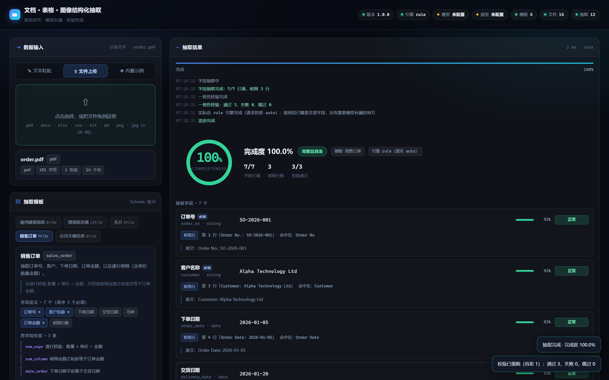
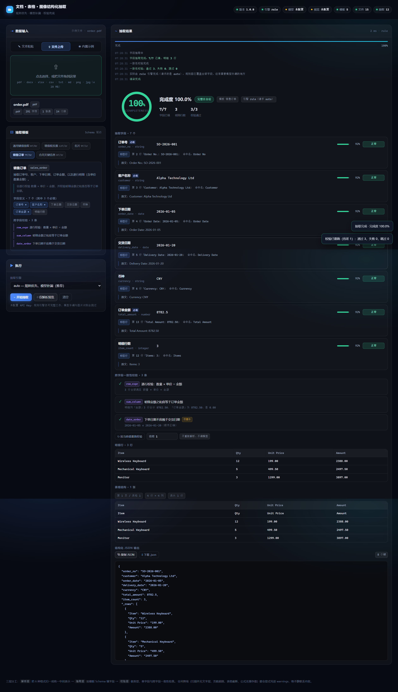

# Doc Extractor · 文档 / 表格 / 图像结构化抽取

> **把一份杂乱的单据变成一份可核对的 JSON**——不是把一个文件丢给模型、祈祷它别编，
> 而是每一层各司其职：解析层负责「把格式抹平」，抽取层负责「填字段」，
> 校验层负责「算一算对不对」。每个抽出来的值都带着**来源定位**和**置信度**，
> 你可以回到原文逐字核对。

[](https://github.com/zhaosibo-1/doc-extractor/actions/workflows/ci.yml)




---

## 这个项目在做什么

「文档信息抽取」的常见做法是：把 PDF 转成一段文字，丢给大模型，让它输出 JSON。
在演示视频里这招很好用，在真实业务里它有三个绕不过去的问题：

| 问题 | 后果 |
| --- | --- |
| **不可核对** | 模型说金额是 2388.00，你没法知道它是从正文读到的，还是按「一般发票都这样」补出来的 |
| **不可复现** | 同一份单据问两遍，字段填的位置可能不一样；报了问题也没法复现 |
| **不会算数** | 「金额 + 税额 = 价税合计」这种幼儿园数学，模型经常做错，而且错得很自信 |

这个项目的做法是**按职责切三层**，让「读」和「算」彻底分开：

```
                    ┌──────────────── 解析层 ────────────────┐
PDF / DOCX / XLSX / │ 格式识别（看文件头，不看扩展名）      │
CSV / TXT / 图片 ──►│ 表格切分（含上下堆叠、多级表头）      │──► Document（统一中间表示）
                    │ 键值行归一（与格式无关，全局只做一次） │
                    └───────────────────────────────────────┘
                    ┌──────────────── 抽取层 ────────────────┐
                    │ 列名命中 (0.95) → 标签命中 (0.92)     │
Document ─────────► │ → 正则命中 (0.80) → 模型补漏 (0.60)   │──► ExtractionResult
                    │ 每一条都记下「从哪来、命中谁、原文是啥」│
                    └───────────────────────────────────────┘
                    ┌──────────────── 校验层 ────────────────┐
                    │ 类型 → 单字段（正则/枚举/范围）        │
ExtractionResult ─► │ → 跨字段（金额+税额=合计、逐行 数量×单价=金额、合计对齐）│──► 完成度 + 规则结论
                    └───────────────────────────────────────┘
```

**关键约束：模型只负责补漏，不负责判断。**
它不会覆盖任何规则层已经抽到的值，也不会参与任何计算。所有的算术、比较、阈值
都是 :mod:`app.validators` 和 :mod:`app.safe_eval` 里的代码，所以同一份单据
永远得到同一个结果，而且每个数字都能手算复查。

---

## 核心特性

### 1. 同一个值，永远说得出它是从哪来的

每个字段都带一个 `source`：

```jsonc
{
  "key": "total",
  "label": "价税合计",
  "value": 2388.0,
  "confidence": 0.92,
  "status": "ok",
  "source": {
    "strategy": "label",                                    // 怎么找到的
    "locator": "第 9 行「价税合计(小写):¥2,388.00」",        // 在哪儿
    "matched_name": "价税合计",                              // 命中了哪个别名
    "evidence": "价税合计(小写):¥2,388.00",                  // 原文长什么样
    "page": 1
  }
}
```

置信度不是拍脑袋的常数，而是按**证据强度**分级：

| 策略 | 基础置信度 | 含义 |
| --- | --- | --- |
| `column` | 0.95 | 从表格里按列名取到的，位置明确 |
| `label` | 0.92 | 「标签：值」结构命中，但标签可能有歧义 |
| `derived` | 0.88 | 由结构推出来的（目前只有「明细行数 = 明细表行数」） |
| `regex` | 0.80 | 正则扫到的，位置对了但语义可能错 |
| `llm` | 0.60 | 模型补漏得到的，**上限刻意压到 0.6** |

`label` 和 `column` 还会按名字匹配相似度做微调；低于 0.55 的匹配直接丢弃 ——
否则「备注」会匹配上「备注说明人」这种字段，而结果看起来完全正常。

### 2. 换个格式存，结果必须一致（这个项目的核心承诺）

`order.xlsx` 和 `order.pdf` 承载的是**同一张订单**：同一个订单号、同样 3 行明细、
同样的数量与单价、同样的 8782.50 合计。区别只在——一个是中文列头，一个是英文列头。

```bash
$ python scripts/e2e_check.py http://127.0.0.1:8000
[6/9 跨格式一致性（本项目的核心承诺）]
  [+] 两种格式的 order_no 一致（'SO-2026-001'）
  [+] 两种格式的 order_date 一致（'2026-01-05'）
  [+] 两种格式的 total_amount 一致（8782.5）
  [+] 两种格式的 item_count 一致（3）
  [+] 两种格式抽出的明细行数相同
  [+] 两种格式的行数量/单价/金额逐行相同
  [+] 英文列头的 pdf 也跑完了全部行级校验（别名机制真的接上了）
  [+] 两种格式的完成度都是 100
```

英文列头能跑同一套校验，靠的是模板里的**列别名**表：

```python
CrossRule(
    key="line_total",
    kind="row_expr",
    expression="数量 * 单价",          # 规则用规范列名书写
    column="金额",
    column_aliases={                  # 真实单据里的其它写法
        "数量": ["Qty", "Quantity", "Sales Qty"],
        "单价": ["Unit Price", "UnitPrice", "Price"],
        "金额": ["Amount", "Line Total", "小计", "金额合计"],
    },
)
```

没有这张表，一份英文列头的报表会让所有行级校验**静默跳过** ——
而「跳过」在界面上看起来跟「没有问题」几乎一样。

### 3. 七份示例，完成度全部 100%，而且都是真算出来的

```
示例               模板            完成度    规则
invoice            invoice         100.0%   票面勾稽：2104.42 + 283.58 = 2388.00，差 0.00
business_card      business_card   100.0%   手机号 / 邮箱格式校验
contract           contract        100.0%   起始日 ≤ 截止日、甲乙方齐全
contract.docx      contract        100.0%   同上（Word 段落与表格按真实顺序解析）
order.xlsx         sales_order     100.0%   3 行全部满足 数量 × 单价 = 金额
order.pdf          sales_order     100.0%   明细列「金额」3 行合计 8782.50，差 0.00
business_card.png  business_card     0.0%   ← 刻意如此，见下
```

上面每一行的「差 0.00」「3 行合计」都是校验层**真的执行了算术**得到的，
不是「没发现问题所以算通过」。验收脚本里专门有一条断言守着这件事：

```python
check(f"{key} 至少有一条规则真的执行了（不是全 skipped）", ...)
```

图片那一行是 **0.0%**，这是设计，不是缺陷：PNG 没有文字层，规则引擎读不出任何东西。
这时结果里会有 `needs_ocr: true` 和一条明确的 warning：

```
这份文档没有文字层（扫描件或图片），未配置视觉模型时无法抽取字段。
```

**降级必须显式**，不能返回一份「看起来正常但少了一半」的结果。

### 4. 引擎到底干活的是谁，说清楚

`auto` 模式的意思是「规则优先、模型补漏」，不是「一定用了模型」。所以结果里分成两个字段：

```jsonc
{
  "engine": "rule",        // 实际干活的引擎
  "engine_mode": "auto",   // 本次请求的模式
  "engine_note": "规则层已覆盖全部字段，没有需要模型补漏的地方"
}
```

界面上顶栏的徽标读的是生效引擎，结果卡片读的也是生效引擎 —— 两处必须是同一个答案。
以前 `engine` 直接写请求的模式，于是同一屏上顶栏写着「引擎 rule」、结果卡片写着
「引擎 auto」。用户看到两个不一样的答案，就再也不会相信其中任何一个。

「点名叫 `llm` 但没配 Key」还会更进一步：**当场返回 400**，而不是等到「恰好有字段
没抽到」才去调模型、才抛异常。曾经的实现是后者，于是出现一个很坑的组合：
一份规则引擎恰好能全覆盖的单据 + `engine=llm` + 没配 Key，会返回 200、
`engine` 字段还写着 `llm`，而实际上一次模型调用都没发生。

### 5. 表达式求值走 AST 白名单，不用 `eval`

跨字段规则允许写表达式（`数量 * 单价`、`amount + tax`）。它不是 `eval` 出来的，
而是用 `ast` 解析后**只允许**白名单里的节点：算术、比较、少量数学函数、已声明的变量。
属性访问、下标、函数调用（除白名单外）、导入、lambda 一律拒绝。

顺手还提供了 `variables_in(expr)` —— 从表达式里提出变量名。
选明细表的逻辑和校验层的列名解析**共用同一个函数**，两边对「这段表达式需要哪些列」
必须给出同一个答案，否则会出现「表选对了但校验说自己缺列」这种自相矛盾的状态。

### 6. 零配置可跑（clone 下来就能看）

不填任何 API Key，服务照常起，抽取走纯规则链路，结果完全可复现。
配上 Key 之后，规则没抽到的字段才会交给模型补漏（置信度上限 0.6，
并且在 warnings 里说明「哪些字段来自模型」）。

---

## 快速开始

```bash
git clone https://github.com/zhaosibo-1/doc-extractor.git
cd doc-extractor

python -m venv .venv && source .venv/bin/activate     # Windows: .venv\Scripts\activate
pip install -r requirements.txt

# （可选）重新生成 7 份内置示例。
# 它们已经提交在 examples/ 里，所以这一步不是必须的 ——
# 单元测试、黑盒验收、CI 用的都是这几份真实文件，而不是测试自己临时造的。
python scripts/make_examples.py

# 起服务
uvicorn app.main:app --reload --port 8000
```

打开 <http://127.0.0.1:8000> —— 深色单页，零构建、零 CDN，断网也不会白屏。
左栏「内置示例」里点一份，再点「开始抽取」，就能看到带来源定位的结果。

想接大模型：

```bash
cp .env.example .env
# 只改这两行，其余留空即用 preset 的默认值
LLM_PRESET=deepseek
LLM_API_KEY=sk-xxxxxxxx
```

**真实 Key 只放在 `.env` 里**，`.env` 已在 `.gitignore` 中；仓库里只有
`.env.example` 的占位符，代码和模板里没有任何硬编码密钥。

用 Docker：

```bash
cp .env.example .env      # 不填也能跑
docker compose up --build
```

---

## 项目结构

```
doc-extractor/
├── app/
│   ├── main.py            # FastAPI 装配 + 17 个接口
│   ├── config.py          # 环境变量 → Settings；路径全部锚定项目根
│   ├── ir.py              # 统一中间表示 Document / Block / Table
│   ├── loaders/           # 解析层：每种格式一个加载器
│   │   ├── __init__.py    #   分发 + 跨格式归一的必经之处
│   │   ├── detect.py      #   格式识别（看文件头 magic bytes）与文本解码
│   │   ├── normalize.py   #   跨格式归一：把「标签：值」行提升为 kv
│   │   ├── text_loader.py #   txt / md / csv / tsv
│   │   ├── pdf_loader.py  #   pypdf 取文字层 + pdfplumber 取表格
│   │   ├── docx_loader.py #   python-docx 段落与表格
│   │   ├── tabular.py     #   XLSX：合并单元格、公式缓存值、日期格
│   │   ├── image_loader.py#   EXIF 校正 + 尺寸信息
│   │   └── table_utils.py #   表头行识别、上下堆叠表格切分、合并单元格还原
│   ├── extractor.py       # 抽取层：列名 → 标签 → 正则 → 模型补漏
│   ├── validators.py      # 校验层：类型 / 单字段 / 跨字段 + 完成度公式
│   ├── safe_eval.py       # AST 白名单表达式求值
│   ├── textutil.py        # NFKC 归一、数字解析、列名解析、相似度
│   ├── templates.py       # 5 个内置模板（字段定义 + 跨字段规则）
│   ├── schemas.py         # 全部请求/响应模型（pydantic v2）
│   ├── store.py           # 上传文件的落盘与内存两种模式
│   └── llm.py             # OpenAI 兼容客户端（文本 + 视觉）
├── web/index.html         # 单页前端（内联样式与脚本，1079 行）
├── examples/              # 7 份内置示例（提交进仓库，测试与 CI 都用它们）
├── scripts/
│   ├── make_examples.py   # 生成 7 份示例
│   ├── minipdf.py         # 224 行的手写 PDF 生成器（示例里的 order.pdf 是它画的）
│   ├── e2e_check.py       # 端到端黑盒验收（只依赖标准库）
│   └── shot_frontend.js   # 真实浏览器渲染验证 + 截图
├── tests/                 # 261 个用例
└── docs/preview.png
```

---

## 抽取流程

```
1. 识别格式        读文件头（ZIP 容器再看内部目录）判断真实类型，不看扩展名
2. 解析            → Document(blocks + tables)，所有格式收敛到同一结构
3. 跨格式归一      把「标签: 值」段落统一提升为 kv 块（全局只做一次）
4. 规则层抽取      列名命中 → 标签命中 → 正则命中，每个候选都带来源
5. 冲突消解        同一字段的多个候选按证据强度排序，分歧记入 disagreements
6. 模型补漏        只处理规则层没抽到的字段；不覆盖已有值
7. 明细行          按「规则用到的列」选表，严格精确匹配 + 覆盖度排序
8. 结构派生        声明了 from_row_count 的字段用数出来的行数补上
9. 校验            类型 → 单字段 → 跨字段；soft 规则失败不扣分
10. 完成度         Σ(权重×状态得分)/Σ权重×100 − 每条失败规则扣 8 分（上限 30）
```

第 4 步的候选不是「谁先找到用谁」。同一次抽取里，一个字段可能同时被标签和正则命中，
分值不同就会被记成一条 `disagreements`；最终选中的那个值会带上它的证据强度，
而在 prompt 里也会把「规则层认为是什么」告诉模型 —— **模型可以补充，但不能推翻**。

### 完成度是算出来的，且能手算复查

```
Σ(权重 × 状态得分) / Σ权重 × 100  −  规则扣分
权重：required = 3，optional = 1
状态得分：ok = 1.0，invalid = 0.5，low_confidence = 0.5，missing = 0.0
规则扣分：每条失败规则扣 8 分，soft 规则不扣，总扣分上限 30
```

`order.xlsx` 的 92.3% → 100% 就是这么来的：7 个字段里 6 个有值，
总权重 13 分拿到 12 分 = 92.3；补上「明细行数」后 13/13 = 100。

---

## API

| 方法 | 路径 | 说明 |
| --- | --- | --- |
| GET | `/api/health` | 服务状态、模板数、模型是否就绪 |
| GET | `/api/config` | 脱敏配置（**绝不返回 Key 原文**） |
| GET | `/api/stats` | 文件数、抽取次数、模型调用数、运行时长 |
| GET | `/api/templates` | 模板列表（字段数 / 规则数 / 描述） |
| GET | `/api/templates/{key}` | 模板详情（字段定义 + 跨字段规则） |
| GET | `/api/examples` | 内置示例列表 |
| GET | `/api/examples/{key}` | 文本示例的内容（一键填充用） |
| POST | `/api/examples/{key}/load` | 把示例载入工作区，返回 `file_id` |
| GET | `/api/files` | 已载入文件列表 |
| POST | `/api/files` | 上传文件（multipart，默认上限 10 MB） |
| GET | `/api/files/{file_id}` | 文件详情与摘要 |
| DELETE | `/api/files/{file_id}` | 删除文件 |
| POST | `/api/parse` | **只解析**，不抽取（`text` / `file` / `file_id` 三选一） |
| POST | `/api/extract` | 完整抽取（解析 → 抽取 → 校验） |
| POST | `/api/extract/stream` | 同上，SSE 流式推送阶段进度 |
| POST | `/api/revalidate` | **只重跑校验**：改规则、改容差不用重新解析、不调模型 |
| POST | `/api/llm/ping` | 模型连通性自检 |

`/api/parse` 的三种输入共用同一条解析链路，所以前端不需要两套渲染逻辑。

### SSE 事件一览

| 事件 | 载荷 | 时刻 |
| --- | --- | --- |
| `start` | `engine` / `engine_mode` / `template` / `doc` 摘要 | 建流 |
| `stage` | `stage` + `percent` + `message` | parse(20) → extract(55) → validate(90) |
| `parsed` | `kind` / `table_count` / `char_count` / `needs_ocr` / `warnings` | 解析完成 |
| `fields` | `filled` / `total` / `rows` / `engine` | 字段抽取完成 |
| `rules` | `passed` / `failed` / `skipped` | 校验完成 |
| `done` | 完整的 `ExtractionResult` | 结束 |
| `error` | `error` / `type` | 出错 |
| `[DONE]` | — | 流结束 |

前端用 `fetch` + `ReadableStream` 消费（`EventSource` 不支持 POST）。

---

## 配置项

| 环境变量 | 默认值 | 说明 |
| --- | --- | --- |
| `LLM_PRESET` | `deepseek` | `deepseek` / `moonshot` / `zhipu` / `qwen` / `openai` / `siliconflow` / `custom` |
| `LLM_API_KEY` | 空 | 真实 Key，**只放 `.env`** |
| `LLM_BASE_URL` / `LLM_MODEL` | 空 | 留空用 preset 的默认值 |
| `VISION_MODEL` | 空 | 图片/扫描件用；留空则图片抽取被明确跳过并给出 warning |
| `EXTRACT_ENGINE` | `auto` | `auto` / `rule` / `llm` |
| `MAX_UPLOAD_MB` | 10 | 上传上限 |
| `PDF_MAX_PAGES` | 60 | 超出部分截断并告知 |
| `TABLE_MAX_ROWS` | 500 | 单表最多保留行数，超出截断并告知 |
| `BLOCK_MAX_COUNT` | 4000 | 最多保留多少个文本块 |
| `DATA_DIR` | `<项目根>/data` | 落盘目录。相对路径按**项目根**解析，不按当前工作目录 |
| `STORE_PERSIST` | `true` | `false` 时上传只留内存（测试用） |
| `CORS_ORIGINS` | `*` | 生产环境请收窄 |

---

## 测试

```bash
pip install -r requirements-dev.txt
pytest -q                       # 261 passed
```

| 文件 | 用例 | 覆盖 |
| --- | --- | --- |
| `test_textutil.py` | 48 | NFKC 归一、数字解析、列名解析与模糊匹配的分工 |
| `test_loaders.py` | 39 | 六种格式的解析、表头识别、合并单元格还原 |
| `test_validators.py` | 38 | 类型/范围/枚举、7 种跨字段规则、完成度公式 |
| `test_table_utils.py` | 27 | 上下堆叠表格切分、多级表头、全文字表格的安全网 |
| `test_extractor.py` | 22 | 选表、候选消解、结构派生、六个示例的端到端抽取 |
| `test_safe_eval.py` | 22 | 白名单拦截（属性访问/导入/lambda/幂爆炸） |
| `test_api.py` | 50 | 接口契约、错误码、路径穿越、SSE 事件序列 |
| `test_config.py` | 15 | 路径锚定、引擎生效值、密钥脱敏 |

### 黑盒端到端验收

```bash
uvicorn app.main:app --port 8000 &
python scripts/e2e_check.py http://127.0.0.1:8000     # 142/142
```

只依赖标准库（`urllib`），所以任何环境都能跑，CI 里也是一个独立 job。
它验证的是单元测试覆盖不到的东西：**把服务真的装起来、跑起来，用户能不能用**。

### 前端渲染验证

```bash
node scripts/shot_frontend.js http://127.0.0.1:8000 docs
```

这个脚本用真实浏览器点一遍「切到示例标签页 → 选示例 → 跑抽取 → 改容差重跑」，
然后断言**渲染出来的几何**而不是 HTML 字符串：

```
结果区: {"fields":7,"rules":3,"rulesPass":3,"srcTags":7,
         "bars":7,"barsWithWidth":7,"dashOffset":0,"ringText":"100%"}
```

`barsWithWidth` 是「置信度条里宽度大于 1px 的有几条」—— CSS 没生效时宽度会是 0，
而 HTML 里元素都在；`dashOffset` 是完成度圆环的弧长，没变就等于没画。
这两类问题截图能看出来，`querySelectorAll(...).length > 0` 看不出来。

<details>
<summary>展开看完整结果页（含明细行表格、表格结构预览与 JSON 输出）</summary>



</details>

---

## 设计取舍

### 为什么不用「一次性丢给大模型」

因为**核对**是这个场景的核心诉求。财务要的不是「73% 像是一张发票」，
而是「这张发票的价税合计是 2388.00，它来自第 9 行，而且 2104.42 + 283.58 确实等于它」。
把判断权交给模型，这三个问题的答案一个都给不出来。

### 「信心不足就交给模型」 vs 「模型优先」

这个项目选的是前者。规则层先跑完，只把**没抽到**的字段交给模型。
好处是省钱、可复现、模型出错的影响面小；代价是遇到格式特别野的单据时，
规则层的产出会很少。这里的取舍是：宁可少抽，也不要抽错还不知道错在哪。

### 列名解析用精确匹配，模糊匹配只用来给模板作者提建议

`resolve_column()` 是**确认**（NFKC 归一后精确相等），`match_score()` 是**猜测**（相似度 / Dice）。
选明细表和行级校验都走前者。理由是：一旦允许模糊命中，就会出现
「金额」匹配到「金额合计」、然后合计校验拿单行金额去比合计的静默错误 ——
界面显示「3 行全部通过」，数字是错的。

### 完成度扣分上限 30 分

一条规则失败扣 8 分，但总扣分封顶 30。因为规则数量会随模板演进增加，
如果不封顶，「一个有 10 条规则但全部通过的模板」和「只有 1 条规则失败的模板」
完成度会倒挂。封顶之后，规则只影响「A/B/C 档」的判断，不会把分数压穿。

### 一处刻意的重复

前端 `loadExample()` 里有一份写死的文本类型名单 `['txt','md','markdown','csv','tsv','log']`，
后端没有对应物。这是纯粹的重复，但删掉它就得让前端先请求一次才知道该走哪条路。
所以选择保留，并用一条契约测试把两边钉在一起：

```python
assert "['txt','md','markdown','csv','tsv','log']" in html, \
    "前端文本示例名单变了，请同步更新 e2e_check.py 里的 TEXT_KINDS"
```

---

## 安全说明

- **密钥**：只有 `.env.example` 里的占位符进仓库；`.env` 被 `.gitignore` 排除。
  `/api/config` 只返回脱敏串（`sk-abc****wxyz`），未配置时返回 `(未配置)` 而不是空串。
- **表达式**：`safe_eval` 用 AST 白名单，拒绝属性访问、下标、导入、lambda 和非白名单函数调用；
  幂运算有指数上限，防止 `9**9**9` 打满 CPU。
- **路径穿越**：上传文件名先做清洗（去路径分隔符与危险字符），`file_id` 只当作
  纯标识符使用，非法值返回 404 而不是 500。
- **资源上限**：上传大小、PDF 页数、表格行数、文本块数全部有上限，
  且**超限一律截断并写入 `warnings`**，绝不静默丢弃。
- **模型调用**：走 OpenAI 兼容协议，超时、重试、错误分类（429/401/5xx）都有处理；
  模型返回的 JSON 用容错解析（先找第一个配平的 `{}`），解析失败降级而不是崩掉。

---

## License

MIT

Copyright (c) 2026 赵思博

<div align="center">

⚠️ **注意**：`.env` 里的 API Key 不会被提交，
但如果你的使用场景涉及真实合同、发票或身份证件，请在部署前自行评估数据合规要求。

</div>
